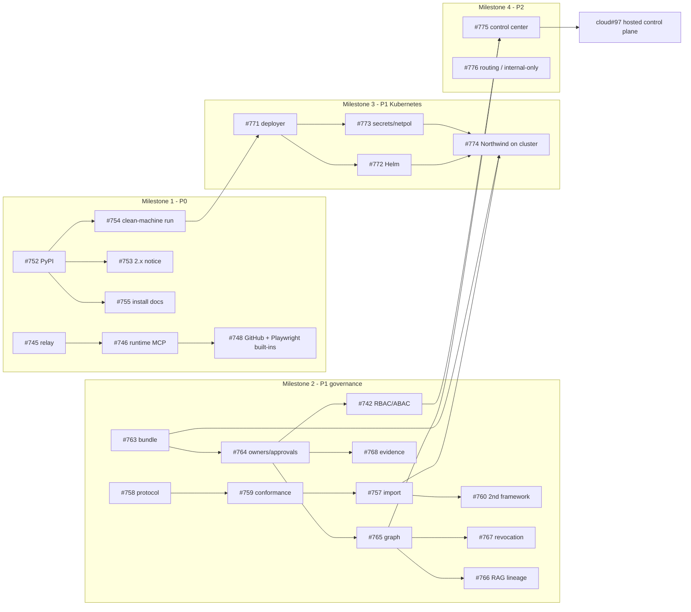

# Roadmap

AgentBreeder's focused rebuild (#648): deploy agents into customer-controlled infrastructure
behind a deploy-time identity gate, with versioned components, eval-gated releases and an
audit trail. This page lists **planned** work in priority order and shows what can run in
parallel. What has shipped and been verified is in [`README.md`](README.md) and
[`ARCHITECTURE.md`](ARCHITECTURE.md). The 2.x roadmap is kept, unmaintained, in
[`docs/history/ROADMAP-2x.md`](docs/history/ROADMAP-2x.md).

Updated 2026-11-10. Issues are the source of truth for scope and status; this page is the
order.

## Principles

- **Claim only what has run end to end.** A roadmap item is not a feature until it has been
  verified, and docs and the website change only then.
- **Every control that makes an agent safe stays in this repository:** the identity gate,
  approvals, revocation, audit, RBAC, evidence export and the single-organization control
  center. `agentbreeder-cloud` adds hosting, fleet operations and compliance mapping on top of
  the same API and never forks it.
- **Each epic** goes through spec, design review, plan, review and the quality gate before code
  is merged.

## Shipped (summary)

| Area | Issues |
|---|---|
| Rebuild baseline: manifest, doctor, local Docker lifecycle | #648 |
| Identity gate, policy, approvals, kill switch, audit chain, MCP egress sidecar | #701 |
| `agent.yaml` → build → eval-gated release; registries and `agent.lock` | #725, #733 |
| Backing services from `stack.yaml`; least-privilege database roles | #734, #749, #750 |
| MCP registry kind, contracts and per-deployment grants; the built-in relay (`services up`); the ADK runtime's MCP client (`runtime/adk@1.1.0`) | #744, #745, #746 |
| Built-in `mcp/github` and `mcp/playwright` (no egress), verified live through `deploy` | #748 |

## Priorities

| Priority | Epic | Why |
|---|---|---|
| **P0** | Installable preview release (#751) | Nobody can try the rebuild without a source checkout |
| **P0, after #751** | `agentbreeder up`: local command center, then Kubernetes on a local cluster (#783) | One place to take an agent from onboarding to a release on two targets |
| **P1** | Governed onboarding of existing agents (#756) | Bring existing agents, in any framework, under the same controls without code changes |
| **P1** | Release bundle and component lifecycle (#762) | Links ownership, dependencies, approval, deployment and revocation |
| **P1** | RBAC/ABAC and authenticated invocation (#742) | Multi-team use; closes the unauthenticated `customer_id` gap |
| **P1** | Production target: Kubernetes with Helm (#770) | Runs in the customer's environment, not only on a laptop |
| **P2** | Control center: `agentbreeder server` and UI (#775) | One place to approve, revoke and trace impact, over the APIs above |
| **P2** | Data-routing policy and internal-only mode (#776) | Makes "data stays inside" checkable; moves to P1 for air-gapped users |
| **P3** | Hosted control plane (agentbreeder-cloud#97) | Consumes the control-center API |

**How #783 relates to other epics.** It pulls a loopback, single-user slice of #775 forward; its API is private and unversioned, and #775 remains the multi-user control center. It delivers the deployer (#771) and secrets and network policy (#773) for a local `kind` cluster only; #772 (Helm) and #774 (real cluster, imported agent) stay in #770.

Next in lane A, unprioritised: the browser forward proxy and per-conversation MCP sessions
(#747; until then `mcp/playwright` has no egress). Deferred: the Slack, Supabase, Google Workspace and Stripe built-ins,
which wait for demand and test credentials. Identity-gate follow-ups (#703, #705, #707) wait on live
identity-provider checks.

## Sequence and parallel work

Work is organised in **lanes**. Items in one lane run in order; lanes run in parallel. A
`needs` column lists cross-lane dependencies.

### Milestone 1 (P0)

| Lane | Order | Needs |
|---|---|---|
| A: MCP | #745 relay → #746 runtime client → #748 GitHub and Playwright built-ins (all done) → #747 forward proxy | — |
| B: Release | #752 packaging and PyPI → #753 2.x notice and #755 install docs (parallel) → #754 clean-machine verification | — |

### Milestone 2 (P1, governance core)

| Lane | Order | Needs |
|---|---|---|
| C: Onboarding | #758 agent protocol v1 → #759 conformance kit → #757 `import` → #760 second framework; #761 bring-your-own gateway and tracing at any point | #757 benefits from #751 |
| D: Lifecycle | #763 release bundle → #764 owners and approvals → #765 registry graph → #767 revocation and #768 evidence export (parallel); #766 RAG lineage after #765; #769 `new agent` at any point | — |
| E: Access | #742 spec at the start of M2; implementation after #764 (owners and teams) | #764 |

### Milestone 3 (P1, production target)

| Lane | Order | Needs |
|---|---|---|
| F: Kubernetes | #771 deployer → #772 Helm chart and #773 secrets and network policy (parallel) → #774 Northwind on a real cluster | Can start after M1 lane B. #774 needs #757 (imported agent) and #763 (bundles) |

### Milestone 4 (P2)

| Lane | Order | Needs |
|---|---|---|
| G: Control center | #775 server and API → UI pages | #765, #742. Its API contract is designed together with agentbreeder-cloud#97 |
| H: Routing | #776 routing policy → closed agent egress → internal-only mode | Independent; can start any time capacity allows |

### Milestone 5 (P3)

| Lane | Order | Needs |
|---|---|---|
| I: Cloud | agentbreeder-cloud#97: API contract → hosted control plane → SAML/SCIM → compliance packs, risk feed, analytics | #775's API |

### Dependency graph

## Maintenance

- #732: real-Docker egress tests are timing-sensitive.
- #588 and #492: kept open for Cloud and the website.
